 

 

  

**Backend** 

**Datos** 

**Cloud & DevOps** 

 

<table width="100%">
<tr>
<td width="50%"></td>
<td width="50%"></td>
</tr>
<tr>
<td width="50%"></td>
<td width="50%"></td>
</tr>
</table>

 

 

Gráficos generados con Python y actualizados a diario por GitHub Actions · <a href="scripts/generate.py">ver el script</a>

