







<a href="https://github.com/GonzalezLazaro/Encuestas-Sistemas">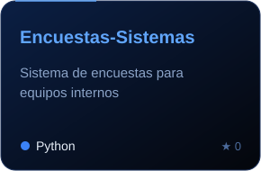</a>
<a href="https://github.com/GonzalezLazaro/api-enlaces">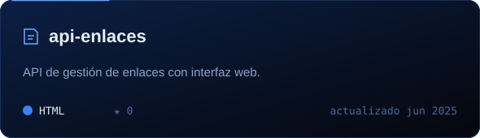</a>
<a href="https://github.com/GonzalezLazaro/api">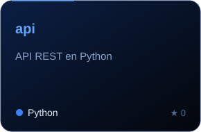</a>
<a href="https://github.com/GonzalezLazaro/Widget">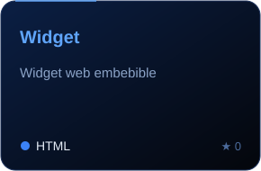</a>



 

